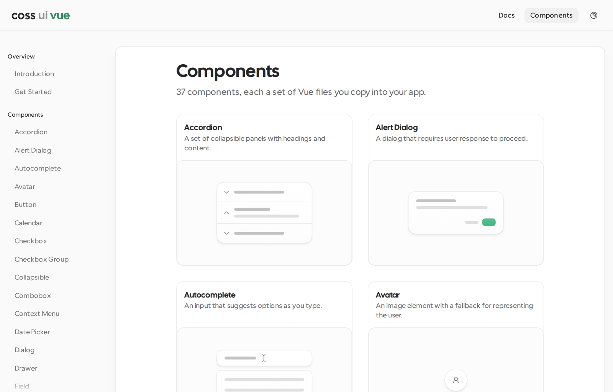

<div align="center">

# coss ui for Vue

**[Visit the website →](https://coss-ui-vue.vercel.app/)**

**The coss ui design, built on Vase UI primitives for Vue 3.**

[](https://vuejs.org/)
[](https://tailwindcss.com/)
[](LICENSE)

[Quick start](#quick-start) · [Install components](#install-components) · [Component source](app/components/ui)

</div>



An unofficial Vue port of [coss ui](https://coss.com/ui). It includes 56 components with light and dark themes, interactive examples, and a [shadcn-vue registry](https://www.shadcn-vue.com/docs/registry). Components are copied into your app as Vue source, not installed as a single npm package.

[Vase UI](https://vase-ui.com/) is the only primitive library. The catalog also includes styled HTML components such as Alert, Card, and Table, and compositions such as Command and Sheet.

## Quick start

Use Node.js 24 and pnpm 10.

```sh
git clone https://github.com/somethingxdev/coss-ui-vue.git
cd coss-ui-vue
pnpm install --frozen-lockfile
pnpm dev
```

Open [the component catalog](http://localhost:3000/docs/components) or the [setup guide](http://localhost:3000/docs/get-started) on the local Nuxt site.

## Install components

With the docs server running, add this namespace to your Vue app's `components.json`:

```json
{
  "registries": {
    "@cossui-vue": "http://localhost:3000/r/{name}.json"
  }
}
```

Then run these commands **from your app**, with Tailwind CSS 4 already configured:

```sh
pnpm dlx shadcn-vue@latest add @cossui-vue/style @cossui-vue/utils
pnpm dlx shadcn-vue@latest add @cossui-vue/button @cossui-vue/dialog
```

The CLI copies the component files, resolves their dependencies, and rewrites imports to use your aliases. If you host the registry yourself, replace `http://localhost:3000` with your deployment URL.

## Development

| Command         | What it does                                             |
| --------------- | -------------------------------------------------------- |
| `pnpm dev`      | Generate the registry and serve the docs                 |
| `pnpm registry` | Generate registry JSON in `public/r/`                    |
| `pnpm build`    | Build the Nuxt site and registry into `.output/`         |
| `pnpm generate` | Generate a static site and registry in `.output/public/` |
| `pnpm run ci`   | Run lint, type checking, and the production build        |

Component documentation lives in `content/docs/components/`, interactive examples in `app/examples/`, and registry generation in `scripts/build-registry.ts`.

## Credits and license

Design and styling from [coss ui](https://github.com/cosscom/ui). Vue primitives from [Vase UI](https://github.com/vase-ui/vase-ui).

Released under the [MIT License](LICENSE).
